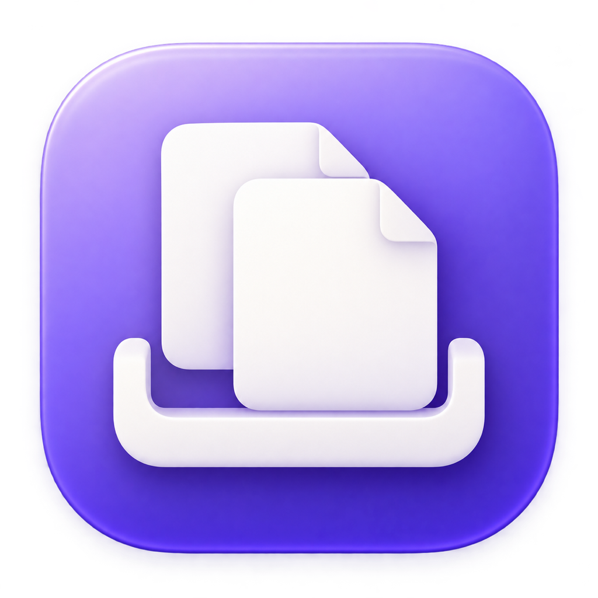

# Plupo — A Free, Open-Source Yoink Alternative for macOS

*Drag. Drop. Keep moving.*



Plupo is a free, open-source macOS drag-and-drop shelf for Apple Silicon. It gives files a temporary home while you work: drag items into the shelf, switch between apps, and drop them wherever you need them.

No complicated workflows. Just drag, drop, and keep moving.

## Overview

Keep a few files close at hand while finding a destination in another window or application. Plupo lives in the menu bar and provides a small floating shelf at the edge of your screen.

The shelf is temporary, not a backup or file manager. File items reference their original locations, and the shelf is not restored after quitting.

## Features

The current source implements:

- Automatic shelf appearance when a drag starts, with hiding when the shelf is empty.
- File drops, including multiple items. Links, plain text, and image data are also handled when the source app supplies a supported representation.
- Native dragging from the shelf to other applications.
- Left or right positioning, with top, center, or bottom alignment.
- Individual removal, item locking, and clearing all unlocked items.
- A preference to keep items after dragging them out, plus three item sizes.
- A menu bar command to show or hide the shelf and open preferences.

Compatibility depends on the representations supplied by the source app and accepted by the destination. Interactive testing across applications and displays is still needed.

## Requirements

- **macOS 15.7 or later**, as configured in the Xcode project.
- **Apple Silicon only (M1 and newer)** is the project's intended support policy.

The current build settings do not yet enforce ARM64-only output. Build explicitly for Apple Silicon as shown below; Intel support is not a project goal.

The app uses macOS drag-and-drop integration and sandboxed, read-only access to user-selected files. There is no explicit Accessibility or Input Monitoring permission request in the current source; cross-application drag detection has not been verified interactively.

## Installation

[**Download Plupo for Apple Silicon**](https://github.com/planetic-labs/open-drag-shelf/releases/latest)

1. Download `Plupo-arm64.dmg` from the latest release.
2. Open the DMG and drag **Plupo** into **Applications**.
3. Eject the DMG and open Plupo from Applications.

These early preview builds use an ad-hoc signature, without an Apple Developer ID certificate or Apple notarization. macOS may block the first launch. If you trust the download, try opening Plupo once, then choose **System Settings → Privacy & Security → Open Anyway** and confirm. See [Apple's first-launch guidance](https://support.apple.com/102445). Do not disable system-wide security protections.

Release downloads include a SHA-256 checksum. The app is built on GitHub for ARM64 without an Apple account or personal signing certificate. You can also build from source below.

## Build from Source

You need an Apple Silicon Mac and Xcode with its macOS SDK and command-line tools selected. The project records Xcode 26.3 as its creation version and uses Swift 5 language mode. Compatibility with older Xcode versions has not been verified. There are no third-party package dependencies; the interface uses SwiftUI and AppKit.

1. Clone this repository:

   ```sh
   git clone https://github.com/planetic-labs/open-drag-shelf.git
   cd open-drag-shelf
   ```

2. Open `Plupo.xcodeproj` in Xcode.
3. Select the **Plupo** scheme and your Apple Silicon Mac as the run destination.
4. Choose **Product → Run**. If signing is required, select your development team in **Signing & Capabilities**. For a personal signed build, use your own unique bundle identifier.

To attempt a local Debug build without signing:

```sh
xcodebuild -project Plupo.xcodeproj -scheme Plupo \
  -configuration Debug -destination 'platform=macOS,arch=arm64' \
  -derivedDataPath build CODE_SIGNING_ALLOWED=NO build
```

The expected output is `build/Build/Products/Debug/Plupo.app`.

The committed source was successfully built for ARM64 with Xcode 27.0 and signing disabled on October 18, 2026. Running the app and interactive drag-and-drop behavior were not verified.

## Usage

1. Launch Plupo, then start dragging a file from Finder.
2. Drop it onto the shelf. Use **Toggle Shelf** in the menu bar if needed.
3. Switch to the destination application or folder.
4. Drag the item from Plupo to its destination.

Use the item's lock button or enable **Keep items on shelf after dragging them out** in preferences when you need to reuse an item. The trash button clears unlocked items; an item's remove button removes it individually.

## Why Plupo?

Plupo aims to be a small, thoughtfully crafted native Mac utility: simple interactions, minimal interruptions, and a focused Apple Silicon experience. It is free and open source under the MIT license.

Plupo is independently developed as an alternative to utilities such as Yoink and Dropover. It is not affiliated with, sponsored by, or endorsed by their developers.

## Project Status

Plupo is in early development. Features and behavior may change. It has not been validated for everyday use.

Known limitations in the published source:

- Drag-out removal checks whether the pointer is outside the shelf, rather than whether the destination accepted the drop. An unsuccessful drag can therefore remove an unlocked item from the shelf.
- The **Launch Plupo at login** preference is stored but does not register a login item.
- The action labeled **Quick Look** opens files and links in their associated applications; text and images use an alert rather than a full preview.
- **Shortcut Only** does not register a system-wide keyboard shortcut. Use the menu bar to toggle the shelf.

## Privacy

The current source contains no networking or analytics code. Shelf contents are held in memory, and preferences are stored locally in UserDefaults. Dragging text or images out creates temporary export files with restricted permissions; these are removed on normal exit or the next launch. A crash can leave them on disk until that next launch. Opening a link or file hands it to its associated application.

Changing the bundle identifier does not migrate preferences from the previous identifier.

## Contributing

Bug reports, feature suggestions, pull requests, and general feedback are welcome. [Open an issue](https://github.com/planetic-labs/open-drag-shelf/issues) with your macOS version, steps to reproduce, and the source and destination apps involved. Please discuss larger changes before starting a pull request.

## License

Plupo is released under the [MIT License](LICENSE).
